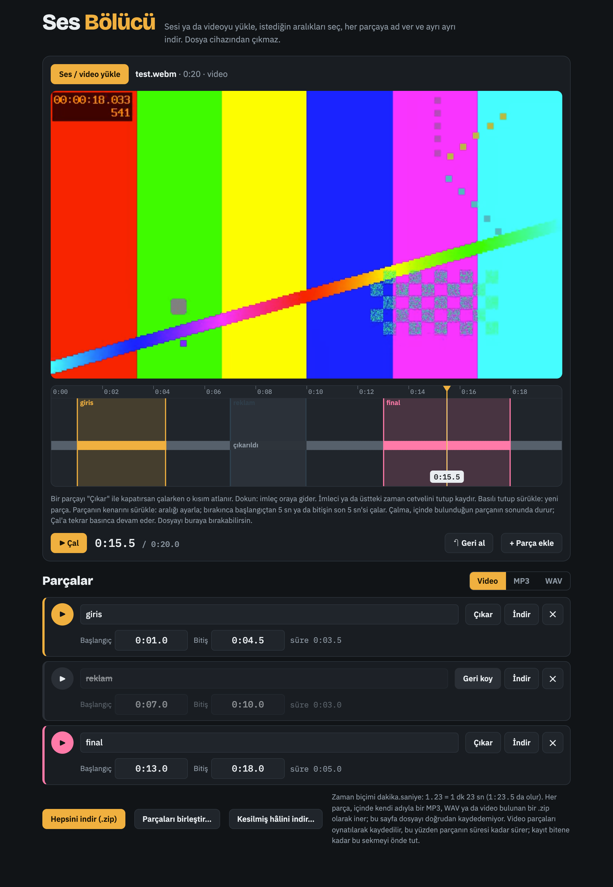

# Ses Bölücü

Ses ya da video dosyasını tarayıcıda böl, parçalara ad ver, ayrı ayrı indir. Dosya cihazından çıkmaz.

**Kullan:** https://deniztanisman.github.io/media-splitter/



## Neler yapar

- **Yükle:** MP3, WAV, M4A, OGG, FLAC ya da MP4 / WEBM / MOV video. Videoda önizleme dalganın üstünde görünür.
- **Parça seç:** dalga üzerinde basılı tutup sürükle ya da başlangıç / bitişi yaz (`1.23` = 1 dk 23 sn, `1:23.5` da olur).
- **Ayarla:** kenarı sürüklerken o anki kare (video) ya da ses duyulur; bırakınca başlangıçtan 5 sn, bitişin son 5 sn'si çalar.
- **Dinle:** Çal, içinde bulunduğun parçanın sonunda durur ve "devam edeyim mi?" diye sorar. Devam edersen parçanın sonu oynatmayla birlikte uzar, durdurduğun yerde biter.
- **Çıkar:** bir kısmı kullanıma kapat; dalgada gri görünür, çalarken atlanır. "Kesilmiş hâlini indir" o kısımlar olmadan dosyanın tamamını verir.
- **Birleştir:** parçaları istediğin sırayla tek dosyada birleştir.
- **Geri al:** her değişiklik (Cmd/Ctrl+Z).
- **İndir:** MP3 (192 kbps), WAV ya da video (WebM). Her parça kendi adıyla bir `.zip` içinde iner.
- **Metin:** indirirken "yazılı halini de" seçersen (toplu indirmede dosya dosya seçilir) Mac'teki yardımcı konuşmayı yazıya çevirip aynı isimle `.txt` ekler.

Video parçaları tarayıcıda oynatılarak kaydedilir: parçanın süresi kadar sürer, kayıt bitene kadar sekmeyi önde tut. Safari / iPhone video kesemez (sesini MP3 olarak alabilirsin); Chrome ya da Edge kullan.

## Mac yardımcısı (isteğe bağlı)

İndirilenler'e düşen Ses Bölücü zip'lerini açar, zip'i siler; istenen dosyalar için Whisper ile (bu Mac'te, internetsiz) `.txt` metin üretir. Türkçe dahil çok dili tanır.

```sh
cd helper && ./install.sh
```

Gerekenler: Apple Silicon Mac, `ffmpeg` (`brew install ffmpeg`), Python 3 (tercihen `uv`). Whisper modeli ilk kullanımda bir kez iner (~1,5 GB).

- `helper/ses-bolucu-unzip.sh` — zip açma + metin. Sadece açıklamasında `ses-bolucu` yazan zip'lere dokunur.
- `helper/folder-action.applescript` — İndirilenler klasör eylemi.
- `helper/install.sh` — üçünü kurar.

Kaldırmak için: Finder › İndirilenler › sağ tık › Hızlı İşlemler › Klasör Eylemleri Ayarları › `ses-bolucu-unzip.scpt` işaretini kaldır.

## Teknik

Tek dosya: `index.html` (kurulum yok). MP3 için [lamejs](https://github.com/zhuker/lamejs), zip için [JSZip](https://stuk.github.io/jszip/), WebM süresi için [fix-webm-duration](https://github.com/yusitnikov/fix-webm-duration) CDN'den yüklenir.
